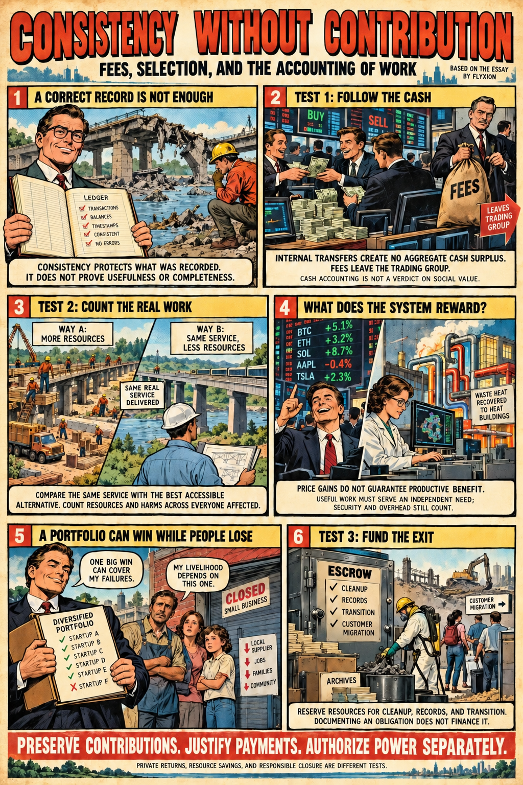

# The Architecture of Coarse-Grained Projection Systems

*Admissible action, semantic structure, physical coordination, and the accounting of useful work.*

This collection develops a research framework for understanding how detailed processes become stable representations, committed actions, and persistent institutions. Its recurring question is what a system must preserve when it compresses information, combines representations, or turns a possible transition into an irreversible event.

The papers approach that question through coarse-graining, constraint closure, semantic entropy, event histories, and admissibility. They investigate connections among cognition, computation, physics, engineering, and economics, while distinguishing the requirements of each domain. A consistent representation, a coherent physical process, and a productive economic arrangement are related achievements, but none automatically establishes the others.

The recommended reading order moves from the organization of action to formal representations, then to global coherence and computational dynamics, before examining engineering and economic applications. It is a conceptual route through the collection rather than a publication chronology.

## Recommended Reading Order

### 1. The Admissibility Log

[The Admissibility Log: Resolution, Commitment, and the Geometry of Action](https://standardgalactic.github.io/research-projects/paper/admissibility-log.pdf)

Begin here for the framework’s account of action and commitment. The paper introduces the admissibility functional, the Null Rail, Aspect Relegation, and the event log: mechanisms for distinguishing ongoing internal processing from transitions ready to become recorded history. Examples from manual work, motor control, and programming explain why waiting, changing resolution, and withholding commitment are active components of skilled agency.

### 2. Semantic Entropy Formalism

[Semantic Entropy Formalism](https://standardgalactic.github.io/research-projects/paper/semantic_entropy_formalism.pdf)

This short technical note introduces semantic entropy as a measure of underspecification, ambiguity, and contradiction within a semantic sphere. It outlines entropy budgets for transformations and merges, together with a distance construction combining entropy differences and modality divergences. Read it as a compact vocabulary for the typed calculus that follows.

### 3. PlenumHub: Typed Semantic Calculus

[PlenumHub: Typed Semantic Calculus (Stage 1)](https://standardgalactic.github.io/research-projects/paper/typed_calculus.pdf)

The calculus gives semantic spheres explicit identifiers, modality signatures, entropy budgets, and provenance. It specifies typed transformations, a partial merge operation, and a Media-Quine closure operator for synthesizing permitted missing modalities. Definitions and proof sketches provide a starting point for implementation and further formalization.

### 4. Error as Obstruction

[Error as Obstruction](https://standardgalactic.github.io/research-projects/paper/error_as_obstruction.pdf)

This paper develops the geometric account of failure: locally acceptable constraints may resist assembly into a globally coherent state. It connects preserved histories, constraint sheaves, projected relaxation, and Spherepop’s event calculus, framing error through obstructions to extension and gluing. Read it for the distinction between local compatibility and global realizability, and for the mathematical program built around that distinction.

### 5. Constraint Closure and Entropic Decimation

[Constraint Closure and Entropic Decimation: Toward a Unified Field Theory of Computation, Cognition, and Cosmology](https://standardgalactic.github.io/research-projects/paper/entropic-decimation.pdf)

This essay develops a computational and field-theoretic treatment of constraint accumulation and admissibility filtering. It introduces an RSVP action with entropy acting as a regulator, then outlines a tensor-train scheme using local gates, operator splitting, and truncation. Its convergence conjecture identifies a research direction rather than a general convergence guarantee.

### 6. A Multimodal Flash–Reluctance Engine

[A Multimodal Flash–Reluctance Engine: Thermodynamic, Electromagnetic, and Mechanical Coupling in a Regulated Rotational Energy Transducer](https://standardgalactic.github.io/research-projects/paper/flash_reluctance_engine.pdf)

The engineering application places thermal expansion and switched-reluctance actuation on a shared rotor. Its design and simulation framework examines thermal depletion, torque shaping, speed regulation, load delivery, and operating regimes. It supplies a concrete setting in which multiple processes must coordinate through shared geometry and limited resources.

[Flash–Reluctance Simulator](https://standardgalactic.github.io/research-projects/paper/flash_reluctance_simulator.html)

An interactive companion for exploring the proposed engine’s modeled behavior.

### 7. Ledger Without Value

[Ledger Without Value: On the Extractive Structure of Cryptocurrency Systems](https://standardgalactic.github.io/research-projects/paper/ledger-without-value.pdf)

This initial economic essay asks whether a system can maintain a correct ownership history while failing to produce useful changes in the world. It introduces the distinction between log-admissibility and positive productivity, then connects speculative redistribution to externalized costs, advertising, and monetized play. Read it as the conceptual precursor to the more qualified accounting framework in the next paper.

### 8. Consistency Without Contribution

[Consistency Without Contribution: Fees, Selection, and the Accounting of Work](https://standardgalactic.github.io/research-projects/paper/consistency-without-contribution.pdf)

This paper revisits the economic argument through three separate questions: what cash transfers establish, whether a system saves resources relative to an accessible alternative, and who funds obligations after an operator exits. Conditional results address cash conservation, the value of price information, selection neutrality, portfolio diversification, and closure reserves. It also examines proof of useful work and the separation of contribution records, compensation, and authority.

The paper distinguishes private financial returns from productive benefits and responsible closure. Success under one criterion does not establish success under the others.

## Shorter Reading Routes

For agency, learning, and commitment, begin with *The Admissibility Log*, then read *Error as Obstruction*.

For semantic systems and implementation, read *Semantic Entropy Formalism* followed by *PlenumHub: Typed Semantic Calculus*, then proceed to *Constraint Closure and Entropic Decimation*.

For a concrete engineering application, begin with *A Multimodal Flash–Reluctance Engine* and its simulator, returning to the foundational papers for the broader vocabulary.

For economics and institutional responsibility, read *Ledger Without Value* followed by *Consistency Without Contribution*. Readers seeking the revised conditional argument can begin directly with the latter.

## Companion Guides

These six documents offer a complementary route through the collection, moving from introductory exposition to operational behavior, technical explanation, system architecture, and implementation. Read them in the order presented, or consult individual guides alongside the papers.

### Narrative Introduction

[Blog Post](blog-post.md)

A narrative entry point introducing the thesis that ideas emerge as convergence phenomena shaped by accumulated constraints and structural conditions. Begin here for an accessible introduction before proceeding to the research papers.

### Framework Overview

[Briefing Document](briefing-doc.md)

A concise overview of the framework, its terminology, and its proposed implications across domains. Read this after the narrative introduction to establish the vocabulary used throughout the collection.

### Processes and Interaction

[Operational Narrative](operational-narrative.md)

A systems-level walkthrough emphasizing process flow, interaction, and emergent structure. This guide connects the framework’s conceptual vocabulary to an account of how its components behave together.

### Mechanisms and Formal Connections

[Technical Explainer](technical-explainer.md)

A detailed conceptual treatment of coarse-graining, projection, and constraint closure. Read it alongside the foundational papers to connect their formal vocabulary with the broader architecture.

### Multimodal Architecture

[System Design](system-design.md)

An architectural treatment of multimodal systems, focusing on co-located domains, torque coherence, and constraint-enforced stability. This guide provides a bridge to the Flash–Reluctance Engine paper.

### Control and Implementation

[Implementation Framework](implementation-framework.md)

A practical treatment of control laws, gain optimization, and deployment considerations within multimodal transduction systems. Read it after the system-design guide and alongside the engine paper and simulator.

## How to Read the Collection

The documents include conceptual proposals, formal definitions, conditional results, proof sketches, simulations, and conjectures. These have different evidential roles. The reading order connects their questions without treating every cross-domain correspondence as an established equivalence.

The guiding distinction is simple: preserving a coherent record is one achievement; establishing what that record permits, enables, or obligates is another.
